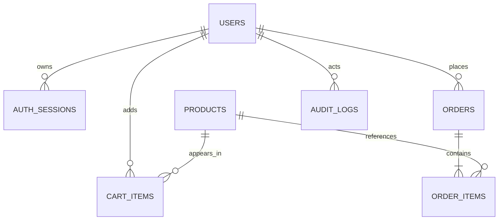
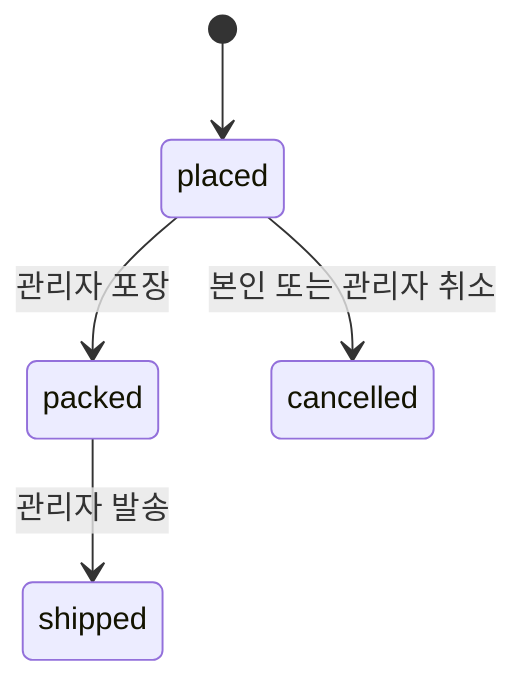

# 설계와 면접 설명 포인트

## 요청 처리 구조

브라우저 React → 동일 출처 `/api` proxy → FastAPI 라우터 → 서비스 → SQLAlchemy AsyncSession → MySQL 순서입니다. 미니콘다는 Python 환경을 관리하며 DB 서버 역할을 하지 않습니다.

`app/core`: 환경 설정·암호 처리. `app/db`: 연결·ORM. `app/schemas.py`: 입력/출력 검증. `app/dependencies.py`: 현재 사용자·관리자 검증. `app/routers`: HTTP 처리. `app/services/shop.py`: 주문·카트·취소 규칙.

첨부의 학습용 CRUD 클래스를 모든 모델마다 그대로 반복하는 대신, 인증은 작은 라우터에 두고 주문처럼 규칙이 복잡한 부분을 서비스로 분리했습니다. 규모가 커지면 서비스별 저장소 인터페이스를 도입할 수 있습니다.

## ERD

| 테이블 | 의미·제약 |
|---|---|
| users | 이메일 unique, bcrypt hash, 관리자 여부 |
| auth_sessions | refresh token의 SHA-256 digest, 만료, 폐기 여부 |
| products | 양수 가격, 음수 불가 재고, 공개 상태, 편집 version |
| cart_items | 사용자+상품 unique, 수량 1~20 |
| orders | 사용자+idempotency_key unique, 주문 상태, 계산된 금액 |
| order_items | 주문 당시 상품명·단가·수량 스냅샷 |
| audit_logs | 관리자 상품 변경과 주문 상태 변경의 행위자·상세 |

금액은 일본 엔화 정수로 저장합니다. float 반올림 오차를 피하며 예시 가격은 표시 금액 그대로 사용합니다. 세율 계산이나 실판매용 세무 명세는 구현하지 않았습니다. 시간은 DB에 UTC naive datetime으로 기록하고 화면에서 UTC임을 명시해 브라우저 시간대로 표시합니다.

## 인증

1. 이메일을 소문자로 정규화하고 입력을 검증합니다. 현재 정책은 이메일 전체를 소문자로 처리합니다.
2. 비밀번호는 8자 이상, UTF-8 72바이트 이하입니다. 긴 비밀번호를 조용히 잘라 같은 비밀번호로 취급하지 않습니다.
3. bcrypt `gensalt(rounds=12)`로 매번 다른 salt를 생성합니다. 비동기 서버를 막지 않도록 CPU 작업은 thread pool에서 수행합니다.
4. 응답 스키마에 password/password_hash가 없습니다. 검증 오류도 Pydantic의 원래 입력값을 제거해 비밀번호를 반환하지 않습니다.
5. access JWT는 15분, React 메모리에만 보관합니다. 브라우저 새로고침 시 HttpOnly refresh cookie로 복구합니다.
6. refresh token은 48바이트 난수에서 만들고 DB에는 SHA-256 digest만 기록합니다. 갱신 시 조건부 UPDATE로 회전하며 이전 token은 거부합니다.
7. 요청마다 JWT 서명·만료·issuer·audience·유형 및 DB 인증 세션을 확인합니다. 로그아웃으로 세션을 폐기하면 발급된 access token도 다음 요청부터 차단됩니다.
8. refresh/logout은 SameSite=Strict cookie와 신뢰 Origin 검사를 함께 사용합니다. Swagger에서 이 두 API를 직접 호출하려면 허용 Origin을 보내야 합니다. 일반 API는 Bearer token을 사용합니다.

현재 refresh 재사용은 401로 차단하지만 토큰 패밀리 전체 강제 폐기나 사용자 보안 알림까지 구현한 것은 아닙니다. 로그인마다 새 세션을 만들며 만료 세션 정리 배치는 후속 작업입니다.

## 주문 정합성

MySQL 연결에 **READ COMMITTED**를 지정합니다. 사용자 행을 잠가 동일 회원의 장바구니 수정과 체크아웃을 직렬화합니다. 이후 상품을 ID 순서로 잠그고 재고와 판매 상태를 확인합니다. `stock >= quantity` 조건을 포함한 UPDATE도 수행합니다.

동일 사용자 행 잠금 뒤 idempotency key를 조회하므로, 같은 키로 재전송된 요청은 기존 주문을 반환합니다. 없는 주문 키에 불필요한 gap lock을 걸지 않고, READ COMMITTED로 이전 요청이 커밋한 주문을 읽습니다. DB unique 제약은 추가 방어선입니다.

가격은 클라이언트에서 받지 않습니다. 서버에서 현재 가격을 읽어 소계·데모 배송비를 계산하고 주문 상품에 당시 값을 복사합니다. 재고 차감 → 주문/항목 INSERT → 카트 DELETE를 한 트랜잭션에서 처리합니다. 중간 품절·오류가 발생하면 dependency가 rollback하여 앞서 차감한 재고도 복원됩니다.

카트에 넣는 것 자체는 재고 예약이 아닙니다. 프론트엔드가 표시한 금액과 주문 시점의 서버 가격이 달라질 수 있습니다. 현재 버전은 주문 시 최신 가격으로 확정합니다. 실결제 전에는 별도 견적 버전·만료 시간·가격 변경 재동의 단계를 추가해야 합니다.

중복 방지 키는 프론트엔드 메모리에 보관하며 확정되지 않은 네트워크 오류 후 재시도에 재사용합니다. 페이지를 완전히 새로고침하면 같은 키를 보존하지 않습니다. 서버의 주문 이력과 카트 삭제가 남지만, 장시간 장애를 포함한 실결제 보장은 별도 결제 상태 머신이 필요합니다.

## 주문 상태

취소는 주문 행 잠금과 조건부 상태 UPDATE로 한 번만 반영됩니다. 재고를 복구할 때도 상품 ID 순서대로 처리합니다. 포장 후 취소·반품·환불은 현재 범위에 없습니다. 동일 상태 재요청은 그대로 반환합니다.

관리자 상품 편집은 `expected_version`을 보내고 현재 version이 같을 때만 업데이트합니다. 주문이 재고를 바꾸어도 version이 증가하므로, 오래 열어 둔 관리자 화면이 최신 재고를 덮어쓰지 못합니다.

## 주요 API

| 메서드·경로 | 권한 | 역할 |
|---|---|---|
| POST /api/auth/signup | 공개 | 가입·세션 발급 |
| POST /api/auth/login | 공개 | 로그인 |
| POST /api/auth/refresh | cookie + Origin | 토큰 갱신 |
| POST /api/auth/logout | cookie + Origin | 세션 폐기 |
| GET /api/auth/me | 회원 | 현재 사용자 |
| GET /api/products | 공개 | 검색·분류·페이지 목록 |
| GET /api/products/{id} | 공개 | 공개 상품 상세 |
| GET /api/cart | 회원 | 본인 카트 |
| PUT /api/cart/items/{id} | 회원 | 상품 수량 지정 |
| DELETE /api/cart/items/{id} | 회원 | 본인 카트에서 삭제 |
| POST /api/orders | 회원 | UUID Idempotency-Key로 모의 주문 |
| GET /api/orders | 회원 | 본인 주문 목록 |
| GET /api/orders/{id} | 본인 | 주문 상세 |
| POST /api/orders/{id}/cancel | 본인 | 접수 상태 취소 |
| GET /api/admin/summary | 관리자 | 데모 집계 |
| GET, POST /api/admin/products | 관리자 | 전체 상품·추가 |
| PUT /api/admin/products/{id} | 관리자 | 버전 확인 후 전체 편집 |
| GET /api/admin/orders | 관리자 | 주문 목록 |
| PATCH /api/admin/orders/{id} | 관리자 | 상태 변경 |
| GET /api/admin/audit | 관리자 | 변경 내역 |

상세 request/response는 실행한 `/docs` 또는 `openapi.json`을 봅니다. 401 미인증, 403 권한 없음, 404 없는/본인 소유가 아닌 자원, 409 중복·재고·버전 충돌, 422 입력 오류를 구분합니다.

## 면접에서 직접 보여줄 5가지

1. 원본 회원 응답에 해시가 포함되던 문제를 출력 스키마 분리로 해결.
2. 주문 당시 가격을 별도 저장해야 과거 주문이 상품 편집의 영향을 받지 않음.
3. 재고 차감과 주문 저장을 한 DB transaction으로 묶은 이유와 실패 테스트.
4. idempotency key, DB unique, 행 잠금이 각자 해결하는 문제.
5. stale version으로 관리자 재고 덮어쓰기를 막는 과정.

MySQL 동시성 검사를 실제로 통과시키고 결과를 확보한 뒤, 면접에서 '동시 요청까지 검증했다'고 표현하세요.
